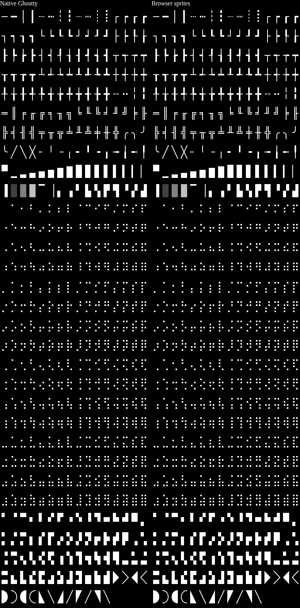

# X3 / E4: procedural atlas sprites

Status: Approved. The original unconditional native-parity keep decision is
withdrawn. Retain font-independent shapes, and enable thickness-dependent sprites
only when the selected font's real positive underline metric is available.

## Review correction

The ascent estimate in `d943282d` was wrong for normal fonts. Installed JetBrains
Mono Nerd Font has 1,000 units/em and a `post.underlineThickness` of 50. At 14 CSS
pixels and DPR 1, native U+2551 covers columns `{3,5}` in a 9×18 cell. The estimate
covered `{1,2,5,6}`, two device pixels away. The old fixtures supplied that same
estimate to native draw functions, so they did not establish native font parity.
The original review reproducer was run unchanged and confirmed this failure.

The new regression reads a real font file independently and failed 20 of 21 common
size/DPR cases before the correction. All 21 pass after removing the estimate.
The installed-font reproducer now gives zero coverage distance at DPR 1, 1.25 and 2.

## Font ownership and scope

`font.metrics` carries raw `head.unitsPerEm` and positive
`post.underlineThickness`, not a measured glyph or an ascent-based estimate.
`readSfntFontMetrics` extracts these fields from uncompressed TrueType/OpenType
bytes. Main-thread callers supply metadata from the same bytes they load; the
worker entry derives it automatically for owned SFNT byte sources. URL loading
retains its existing font-loading behavior. Compressed WOFF/WOFF2 and externally
loaded/system fonts need separately supplied table metadata. Otherwise box drawing
and outlined powerline symbols remain on the font-text path. Their old font seams
are not claimed fixed without that metadata. Missing or nonpositive metrics never
activate an estimated procedural stroke.

Font metadata is copied and validated at the public boundaries. Metric-only
changes invalidate font-scoped glyph caches even when grid geometry is unchanged.
Changing family or primary weight clears previous metadata unless the update
provides replacement data. The worker's owned font tables take precedence.
[The API guide](../../../docs/procedural-sprites.md) records this contract.

WebGPU, WebGL2, their worker entry and Canvas pixels mode use the shared atlas.
Plain Canvas2D and DOM still draw font text. Blocks, braille, sextants and filled
powerline shapes need no stroke metric and remain procedural for any font.

## Independent native reference

The generator compiles pinned Ghostty draw code at
`7b11f3dca034d8d24369ad3856afe57946d7902a` with native Zig 0.16.0. Only imports,
assertions and I/O ownership are adapted; draw geometry stays unchanged. This is
native sprite-code output, not an installed Ghostty screenshot.

It now reads the bundled JetBrains Mono regular font with FreeType 2.15.0,
using `FT_Get_Sfnt_Table(post)` and `FT_Size_Metrics.y_ppem` as the pinned
Ghostty face does. Raw `head`/`post` table checks independently verify those
fields. Reference thickness is `ceil(underlineThickness * y_ppem / unitsPerEm)`.
No browser result or estimate supplies reference thickness. The font is from
`@fontsource/jetbrains-mono` 5.3.0, decompressed with `woff2_decompress`, and its SIL
OFL license is included. Its SHA-256 is
`473c93ad62d89abd8431c8f5d744c83fe2e3f87d05b2f80c06355f240058d813`.

The 37 sheets cover all 492 selected codepoints: the nine requested cell/DPR
combinations, a two-cell span, and font sizes 14, 16, 16.1, 18, 20, 20.1, 24, 28 and 32 at DPR
1, 1.25 and 2. The browser independently reads the loaded font file, verifies its
SHA-256 and compares 18,204 samples. Rectangles match exact alpha bytes; curves
and diagonals retain the symmetric one-device-pixel gate at alpha 32/255. This
includes the double-line regression. Font/text/style/span keys stay unchanged.



Run the generator and comparison with:

```sh
python3 scripts/sprites/native-reference.py \
  /work/projects/references/web-terminals/ghostty-org__ghostty \
  /work/tools/zig/0.16.0/zig \
  /work/cache/zig/p/z2d-0.12.1-j5P_Hsw8EQAKyZTQICCQnAH2xYkLDW8k9uefbsYdfPZ-.tar.gz \
  src/render/shared/atlas/sprite-fixtures
bun run test:browser src/render/shared/atlas/sprites.browser.test.ts
```

## Historical cost evidence and limits

The retained timing packet measures runtime `abe63a8c0`, before this correction,
against `d2ed8989a` on the PC RTX 3060 Ti in headed Chromium 153.0.8010.12.
It covers one terminal, 100×30 cells, DPR 2 and warm-atlas workload replay only.
The shared plan's broader defaults and Mac measurements remain untested. The Mac
reservation explains the omission; it does not replace that evidence. No fresh
performance qualification is claimed for the revised metric-gated path.

The old +1.9% unicode ratio of separate medians is inconclusive. Independent review
found median paired deltas of 0 ms for WebGL2 and +20 ms for WebGPU, with exploratory
bootstrap mean intervals containing zero. This establishes neither a regression
nor proof of zero cost. Historical screenshots and packet counts remain available;
the old geometry keep claim must not be inferred from them.

## Verification and cleanup

The updated font-backed atlas/compositor gate passes 109 browser tests, including
18,204 native samples. Two worker tests cover owned-font metadata and byte
ownership. Native generation and the real-font regression pass. Fresh build,
typecheck, lint and formatting passed. The final unit gate passes 1,138 tests
with one skip, plus 482 comparison tests and four checkpoint tests. Host/font
resource and Canvas pixels checks pass 26 tests; docs checks pass seven tests.
The compositor oracle remains strict and uses padded software Canvas; its
procedural geometry has the independent native-font comparison above.

Raw receipts are retained under
`/work/reports/ghostty-webgpu-next-2026-10/X3/revision-1/`. The coordinator owns
retained review evidence until PR resolution and archival. Temporary compilation,
font conversion, browser resources and the task worktree are removed after push.
Checked-in native/font fixtures remain owned by these regression tests. The wasm
build and its unpatched-source contract are unchanged.
