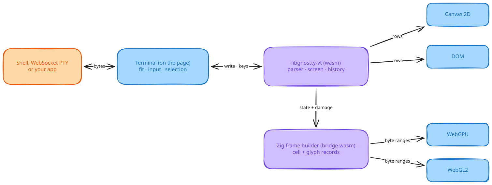
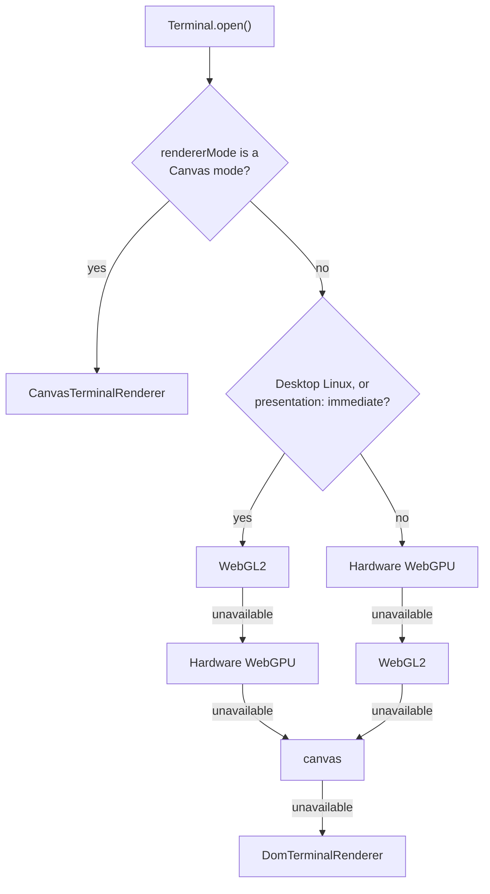

# How ghostty-webgpu works

This page explains where terminal state lives, how a frame reaches the screen, and why the library has four renderers. It is background, not a procedure. For tasks, use the [guides](https://ghostty.shaulavo.dev/docs/).

<picture>
  <source media="(prefers-color-scheme: dark)" srcset="assets/architecture.dark.svg">
  
</picture>

Read the diagram left to right. Only the purple boxes know what the terminal contains. Everything else asks them.

## One terminal state

Ghostty's `libghostty-vt` parses the byte stream and owns the active screen, cursor, modes, and scrollback. The library compiles it to WebAssembly from an official upstream revision without patches. [ADR 001](adr/001-unpatched-pinned-ghostty-core.md) records why. `ghostty-vt.provenance.json` records the revision, compiler, and build recipe.

Four classes expose that state at different depths.

- `GhosttyRuntime` (browser or Node): loads the wasm core.
- `GhosttyTerminal` (browser or Node): headless reads and writes of one terminal.
- `TerminalSession` (browser or Node): the native session model, with selection and events.
- `Terminal` (the page, or a page host around a worker): the DOM host, with fitting, focus, input, links, and a renderer.

Selection, `readLines`, accessibility text, and every renderer read the same native state. That is why a resize or a renderer switch never loses the screen.

## From bytes to pixels

`write()` changes emulator state at once. Painting is separate and follows a scheduler. The core records damage, the rows and cells that changed, and the renderer uses it to decide what to repaint.

- **WebGPU and WebGL2** use a frame builder written in Zig and shipped as `bridge.wasm`. It keeps persistent cell and glyph records for the whole viewport. JavaScript rasterizes any glyph the browser font has not drawn yet, then uploads only the changed byte ranges.
- **Canvas 2D and the DOM** read rows straight from the core and repaint changed rows with their own reuse strategies.

A resize, font change, palette change, or lost GPU resource can need a full repaint. `onFrame` reports the rows each submitted frame painted.

Two reads answer different questions. `readLines` reads live native state, which can be ahead of the screen. `visibleLines` reads the last submitted viewport, which is what the user sees. See [damage tracking](https://ghostty.shaulavo.dev/docs/concepts/damage-tracking/) for observers.

## Four renderers and the order they are tried

One renderer cannot cover every browser. WebGPU and WebGL2 draw on the GPU, Canvas 2D needs neither, and the DOM works anywhere text does. `Terminal.create()` tries them in order and falls to the next on a capability failure.

Automatic selection skips software WebGPU adapters. `backend` is an option of the worker entry only, and an explicit `backend: 'webgpu'` there accepts any adapter. The main entry has no `backend` option. It takes `rendererMode` or a `rendererFactory`. After a lost WebGL context, the main entry follows the remaining order. The order lives in `src/render/shared/backend-order.ts` and `src/render/shared/selector.ts`. Desktop Linux tries WebGL2 first because it measured lower CPU work there ([changelog 0.3.22](https://github.com/ShaulLavo/fregat/blob/main/packages/ghostty-webgpu/CHANGELOG.md)).

## The worker entry

`ghostty-webgpu/worker` puts the wasm core, the frame builder, and a GPU renderer in a dedicated worker. The DOM host stays on the page and owns focus, pointer input, and layout. Operations that need the worker's answer return promises. The worker supports WebGPU and WebGL2. It has no Canvas modes and no link providers yet. See [status](status.md) and the [worker guide](https://ghostty.shaulavo.dev/docs/guides/workers/).

## Where to go next

- [API behavior reference](api.md) for the exact rules of frames, scrollback, geometry, and extensions.
- [Status and limits](status.md) for what is solid and what is not.
- [Terminal comparison benchmarks](benchmarks.md) for the CPU numbers.
